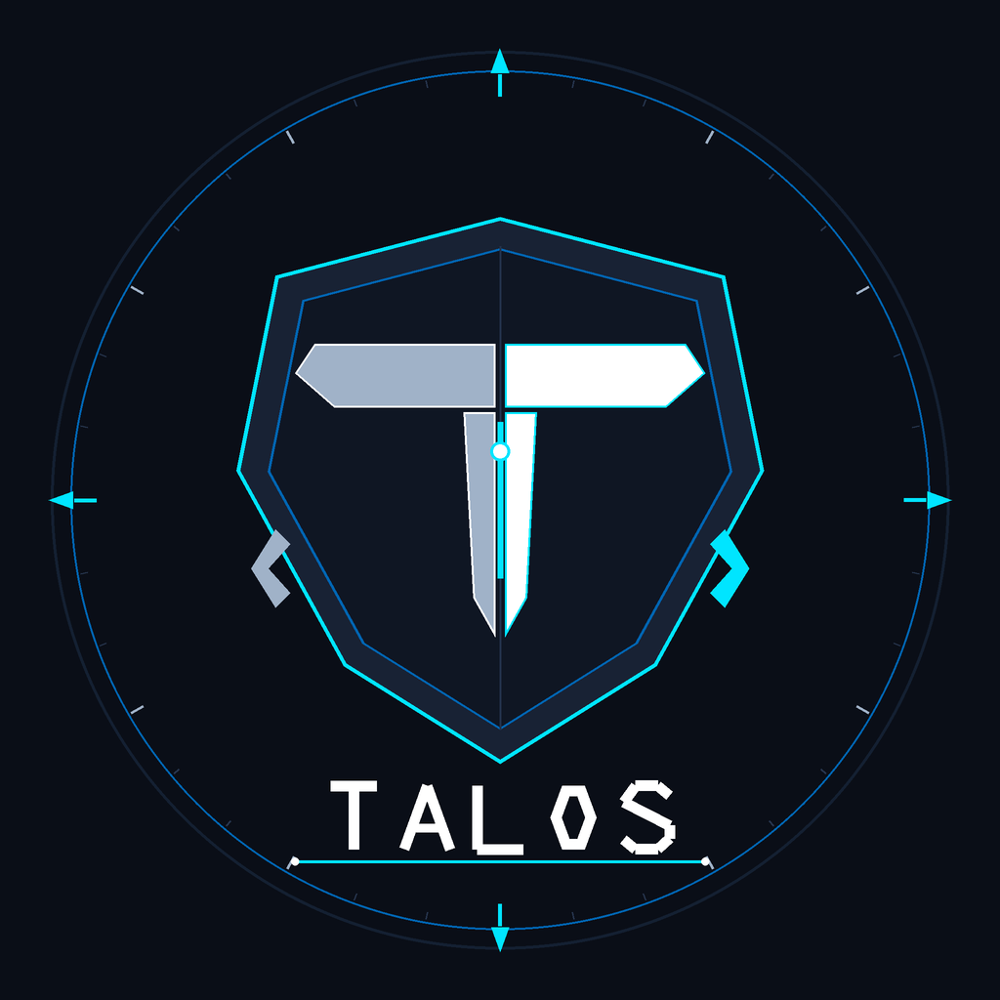

# 🛡️ TALOS — Système de Reconnaissance et de Franchissement Autonome en Milieu Dégradé

[](https://www.defense.gouv.fr/aid)
[](https://www.unitree.com/)
[](https://mujoco.org/)
[](https://www.ensta-bretagne.fr/)
[](https://huggingface.co/Phyl0x/TALOS-Unitree-G1-RL)

<p align="center">
  
</p>

---

## 🎯 Mission Opérationnelle
Inspiré de **Talos** — le premier automate autonome de la mythologie grecque forgé par Héphaïstos pour protéger la Crète — le projet **TALOS** répond au défi de la reconnaissance terrestre et du franchissement autonome en milieu clos ou sous guerre électronique sévère (bâtiments effondrés, escaliers, couloirs étroits $\le 70\text{ cm}$, dévers à $30^\circ$ et brouillage total du signal GNSS/GPS).

Le binôme robotique tactique associe :
* **Unitree G1 (29 DDL)** : Robot humanoïde bipède avec mains préhensiles motorisées Dex3-1 pour le franchissement vertical et la manipulation.
* **Unitree Go2** : Robot quadrupède éclaireur tout-terrain avec Lidar 4D pour la cartographie rapide et le relais de communication.

---

## 👥 Collectif d'Ingénierie (ENSTA Bretagne & Partenaires Industriels)
* **Mathis BEAUDUCEL** (*Safran Electronics & Defense*) : Architecte & Firmware bas niveau, microcontrôleurs, cartes de vol critiques.
* **Arlann LAUNAY** (*Safran Electronics & Defense*) : Bancs d'essais automatisés (TestStand / C++), cartes multicouches KiCad, avionique.
* **Ayoub OUZANI** (*ArianeGroup*) : FEA, dynamique des matériaux énergétiques, guidage de robots mobiles autonomes.
* **Yurii KHARKIVSKYI** (*Breizelec*) : Bancs calculateurs ECU, bus CAN temps réel, diagnostic matériel et télécommande sécurisée pour engins autonomes.

---

## 🏗️ Architecture Technique
```text
├── 01_DEPOT_AGORIZE/      # Dossier officiel de soumission & CVs
├── Proposition_Projet/    # Dossier de candidature A4 & identité graphique
├── unitree_mujoco/        # Environnement de simulation physique MuJoCo (scènes & obstacles)
├── unitree_rl_gym/        # Politiques d'apprentissage par renforcement (PPO/SAC)
├── unitree_ros2/          # Nœuds ROS 2 de navigation, SLAM Lidar et communication
├── unitree_sdk2_python/   # SDK2 officiel Python Unitree (G1 & Go2)
├── bot_talos_ai.py        # Bot Discord connecté à Mistral Pro & Google Gemini
└── setup_discord.py       # Déploiement automatique du serveur Discord de mission
```

---

## 🚀 Liens Utiles
* **Dépôt Hugging Face des Modèles :** [Phyl0x/TALOS-Unitree-G1-RL](https://huggingface.co/Phyl0x/TALOS-Unitree-G1-RL)
* **Dataset de Télémétrie & Cartographie :** [Phyl0x/TALOS-Dataset](https://huggingface.co/datasets/Phyl0x/TALOS-Dataset)
